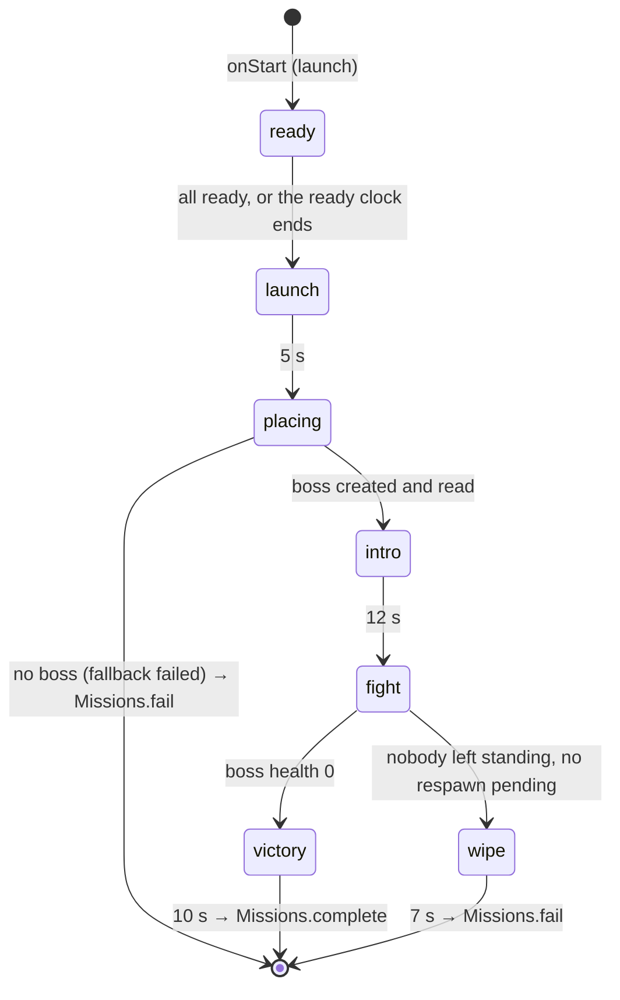

# PvE missions and the Chimera raid: how they work

An analysis of the PvE mission system, with the Chimera raid as the worked example, written as the groundwork for a
BT-7274 Titan mission. Code as of `e1a47fd` (2026-11-04, branch `feat/titan-pve-mission`); line numbers refer to that
commit. Paths are relative to `resources/gamemodes/op77_lightrp/` unless they start with `ui/` (repository root) or
name the Open77 repository.

Facts below were read in the code. Anything inferred and not read is marked *(inference)*; nothing here was run in game.

## 1. The two halves: the board and the script

`server/modules/missions.lua` is the entry half: mission points, boards, crews, lobbies, launch, the instance, its clock
and its end. What happens inside an instance belongs to a **mission script** registered for the point:

```lua
Missions.register(pointId, script)    -- missions.lua:723 (unregister :724)
Missions.complete(instanceId)          -- :662
Missions.fail(instanceId, why)         -- :663
```

Three kinds of point feed it:

| Source | Defined in | Script |
|---|---|---|
| Config points (Chimera, Sector 04) | `server/config/missions.lua` (`points`) | a module of its own: `server/modules/mission_chimera.lua` registers `chimera_raid` (`:584`) |
| Authored missions | the staff editor (`server/modules/mission_editor.lua`, `docs/mission-editor.md`) | `server/modules/mission_engine.lua`: `Engine.publish(def)` → `Missions.register(def.id, script(def))` (`:793`), `Engine.withdraw` (`:803`) |
| Fixer gigs | `Missions.launchGig` (`missions.lua:1239`) | the authored-mission script, plus `inst.gig.onEnd` |

`Missions.addPoint` / `removePoint` (`:1175`, `:1193`) add and retire points at run time; `Missions.launchNow`
(`:1213`) launches without a board.

Note: the Sector 04 board has no script on this branch (`server/config/guide.lua:97-99`, "has a board but no mission
script registered").

## 2. A mission's life

### Board, crew and lobby

- A point's board opens with **E** (interaction radius 2.0, bucket 0, `missions.lua:1273-1282`).
- Entry is by crew (`server/modules/parties.lua`). Only the crew leader tags the crew in, and a player alone is a
  crew of one.
- A crew gets its own lobby. With the leader's matchmaking switch on, strangers fill the free places
  (`missions.lua:1-10`, `tag` `:420`, `pickLobby` `:303`).
- Difficulty gates: `reputation.difficultyTiers` {standard 1, hard 2, critical 3}, `requireTier`, `requireClear`
  (`server/config/missions.lua:29-31`). Since the owner decision of 2026-11-04 a member under the gate still enters and
  plays; only their reputation drops (`docs/pve-progression.md:305-309`).
- The countdown starts at the difficulty's minimum: 15 s, or 10 s when the host launches (`countdown`,
  `hostCountdown`, config `:44-45`). Untagging, leaving, going down or wandering past `C.leash` cancels it
  (`missions.lua:1031`, `:1076`).

### Launch (`launch`, `missions.lua:749-809`)

1. Everyone is checked again; a member who is not eligible is untagged. Below the minimum the lobby reopens
   (`:752-768`).
2. The instance is created:
   ```lua
   { id = "mission:<n>", point, difficulty, bucket = C.bucketBase + n,   -- bucketBase 3000000
     members = { ids }, startedAt, endsAt = now + minutes * 60000, state = "running", test, gig }
   ```
   (`:771-772`). **Every run has its own routing bucket.**
3. Each member is teleported **asynchronously** (`CreateThread` + `Open77.players.teleport(..., { bucket = inst.bucket,
   fade, dismount, timeoutMs = 30000 })`) to `point.start[slot]`, behind a zone-loading cover (`:783-796`). A member who
   cannot be placed leaves the instance and stays in the city (`:790-795`).
4. `script.onStart(inst)` is called **right after the teleports are started, not after they finish** (`:803-807`).
   On `onStart` the operators are still on their way to the bucket.

### Running (`missions.lua:1045-1073`)

One server loop, every 500 ms:

- **The clock.** `t >= inst.endsAt` fails the run: "time ran out" (`:1058`).
- **The squad frame** (health and life states) is pushed when it changed (`:1060-1065`).
- **`script.onTick(inst, secondsSinceStart)`**, at most once a second (`:1066-1071`).

Other entry points into a running instance:

- `onLifeState(inst, id, phase)` on every life-state change (`:1030-1038`). A death in a running mission belongs to the
  script: there is no unconscious state and no hospital (`Missions.handlesDeath`, `:666`).
- `onLeave(inst, id, why)` when one operator leaves: abandon, disconnect or character change (`leaveInstance`,
  `:728-747`). The member is removed from `inst.members`; the last one out fails the run ("every operator left").
- `script.view(inst, viewer)` adds the script's objective to the HUD's instance view (`instanceView`, `:512-523`).
- `Missions.extend(inst, seconds)` adds time to the clock (`:722`).

### End (`finish`, `missions.lua:577-660`)

`complete` and `fail` both call `finish`, which returns at once if the instance is no longer running (`:578`), so a
double end is harmless. Its order matters to any script:

1. `inst.state` = complete/failed; the instance is removed from `instances` (`:579-580`). From here on
   `Missions.instanceOf(id)` returns nil.
2. `script.onEnd(inst, success, why)` in a `pcall` (`:582-586`).
3. The end-of-mission recap (`:588`).
4. Payouts (`LightRP.missionPay.settle`), only on success and never for a test run (`:590-594`).
5. For each member: notices, reputation and clears, recap, **`sendHome` (bucket 0, at the point's board)**,
   `restoreArms` when the script handed out weapons (`inst.loadout`), queue push (`:595-646`). A member who is down is
   respawned at the point instead of teleported (`sendHome`, `:541-571`).
6. `LightRP.eachModule("onMissionFinished", inst, point, d, success, why, payouts)` (`:648`): dailies, titles.
   `docs/dailies-titles.md` cites `missions.lua:627`, which is stale.
7. The gig's `onEnd`, then retired-point cleanup (`:649-659`).

### Payouts and reputation

`server/modules/mission_pay.lua` (`settle` `:255-281`) pays a crew pot shared by `missions.crewExponent` (0.7), with a
per-point cooldown, a repeat share and a daily cap (`server/config/economy.lua`). Reputation: 100 / 220 / 450 per
difficulty, 25 % for 60 min on the same point after a full grant (`docs/pve-progression.md:39-58`,
`docs/economy-balance.md` §16). The Chimera pays 3 000 / 4 500 / 6 000 per head (config `:113-121`).

### Weapons during a mission

- A script that sets `inst.loadout = true` owns the native weapon slots. Several pieces depend on it:
  - `Missions.handlesLoadout` (`:669-672`);
  - the weapon wheel lists the script's kit (`kitOf`) and hands it out again (`reissueKit`) (`Missions.kitOf` /
    `drawKit`, `:675-707`).
- The character's RP weapons come back 3 s after the run (`restoreArms`, `:708-716`).

## 3. The Chimera raid (`server/modules/mission_chimera.lua`)

### The point and its tuning

The point `chimera_raid` (`server/config/missions.lua:92-121`):
- type `RAID`, "Chimera Protocol", in the Dogtown arena;
- `arena`, `boss` stand, 8 `start` spots;
- difficulties:

  |Difficulty|Pay per head|Clock|Crew|Tier|
  |---|---|---|---|---|
  |Standard|3 000|20 min|1–4|1|
  |Hard|4 500|25 min|2–6|2|
  |Critical|6 000|30 min|4–8|3|

`LightRpRaid` (config `:125-215`) holds everything else:

|Knob|Standard|Hard|Critical|
|---|---|---|---|
|Boss health ×, + per operator past the first|1.0, +0.45|1.8, +0.6|3.0, +0.75|
|Boss damage ×|0.8|1.1|1.5|
|Respawn / team lives|8 s / unlimited|18 s / 6|none / 0|
|Reinforcement waves at health %|75, 40|85, 60, 35, 15|90, 70, 50, 30, 10|
|Adds per wave (+ per operator)|2 (+1)|3 (+1)|4 (+2)|
|Enrage|12 min, ×1.5|10 min, ×1.6|8 min, ×1.8|

Plus: timers (ready 45 s, load wait 120 s, load radius 90 m, launch 5 s, intro 12 s, victory 10 s, `:127-132`), the
barrage and purge strikes (`:160-164`), the phase pace (`:173`), `repairSeconds` 15/25/35 (`:176`), body-hit pricing per
kit (`:177-185`), resupply (`:189`), the five kits assault / breacher / marksman / gunner / tech (`:193-209`) and the
music (`:214`).

### Its state machine (`onStart` / `onTick`, `:584-643`)



- **ready** (`onStart` `:594-607`).
  - Kit 1 for everyone, `inst.loadout = true`, and the armament stands aside (`LightRP.armament.push`).
  - Each client reports "loaded" once in the arena (`op77_lightrp:raid:loaded`, checked against `loadRadius`,
    `:727-739`). Ready (key or page button) is refused until then (`:698-705`).
  - While someone is still loading, the ready clock is extended one second at a time, up to `loadDeadline` (120 s).
  - At the deadline the raid launches anyway, even with an operator still loading (`:613-619`).
- **launch** → **placing**. `placeBoss` asks `open77_chimera` for the boss in the instance's bucket and polls the
  result every tick. Failure, or 7 s without a result, falls back (`fallbackBoss`, `:417-446`, `:622-630`).
- **intro**. The boss is passive: combat off, invulnerable, native AI on (`bossPlaced`, `:404-415`). Clients play the
  cinematic.
- **fight** (`beginFight` `:384-401`; `fightTick` `:467-555`).
  - The difficulty's multipliers are sent to the provider (`setDifficulty`), and the operator count is frozen
    (`raid.operators`, `:395`).
  - Each tick runs: the target lock (+25 s), the barrage (+6 s) and purge (+4 s) strikes, reinforcement waves at their
    health thresholds, the repair cut-short, the batched body damage, resupply and enrage.
- **Life** (`onLifeState` `:644-673`, `lifeTick` `:558-579`).
  - Before the fight a death costs nothing (respawn in 3 s).
  - During the fight a down counts (`raid.downs`) and uses a team life with a respawn delay. With no life left the
    operator is out until the end.
  - Back alive, the kit is handed out again.
- **onEnd** (`:681-693`).
  - Fires `onRaidFinished` (iconic implants, `server/modules/cyberware_iconics.lua:125`).
  - Writes `inst.report = { enraged, downs, operators }`.
  - Clears the reinforcements and sound loops, removes the boss and tells every client `ended`.

### Damage

- **Shots on the boss.** The provider prices the body near zero, so each operator's client relays its confirmed hits
  (`open77:npcHit` → `op77_lightrp:raid:hit`, at most one per 0.03 s, `client/core/raid.lua:378-388`).
  - The server checks: fight phase, not repairing, the shooter alive and within 90 m.
  - It prices the hit by the shooter's kit: `perHit` %, capped by per-player tokens refilled at `perSecond` %, ×
    `armored` in the armored phase.
  - It adds the result to `raid.bodyDamage`, applied once per tick through the provider's `applyDamage`
    (`:744-769`, `:531-538`).
  - The provider's 17 weak points change the boss's health on their own path (open77_chimera `server.lua:568-582`).
- **The boss's hits on players** are applied by the provider with its own validation: epoch, sequence, 120 m, same
  bucket, rate caps (open77_chimera `server.lua:632`).
- **Reinforcements** are platform NPCs created by the raid (`spawnAdd` `:138-171`).
  - Settings: `aiMode = native`, mortal, `hitPricing = "platform"`, combat group `open77_chimera`.
  - Their hits on players reach `mission_engine`'s `onNpcPlayerHit`. That handler falls back to
    `LightRP.raidReinforcementHit` (`mission_engine.lua:642-656`, `mission_chimera.lua:775-788`).
  - The legacy client relay is held 600 ms so a hit is never counted twice (`mission_engine.lua:607-631`; commits
    `96ef7ff`, `72d9ef6` of 2026-11-04).

### The boss provider (`open77_chimera`, Open77 repository)

`resources/gamemodes/open77_chimera/server.lua` owns the encounter. The raid drives it only through
`Open77.exports.callSync` (`mission_chimera.lua:35-40`).

- It exports creation and placement, `result`, `get`, `list`, `setDifficulty`, `applyDamage`, `setHealth`, `setTarget`,
  `setCombatEnabled`, `setDamagePolicy` and `remove`.
- Health-ratio transitions (`server.lua:245-271`):

  |Health ratio|Transition|
  |---|---|
  |≤ 0.7|armored → exposed, with a 60 s invulnerable repair (the raid cuts it short)|
  |≤ 0.4|the gas flag|
  |≤ 0.01|core|
  |0|dead|

- The encounter's controller is the calling resource; `list` is scoped to it.

### Client and page

- `client/core/raid.lua` covers the ready key (`RegisterKeyMapping`), the raid sounds and music, the strike telegraphs,
  the intro camera, the "loaded" report and the hit relays.
- `ui/src/features/missions/RaidHud.tsx` covers the intro beats, the ready check and kit picker (keys 1–5), the boss bar
  and the banners.
- Both are Chimera-specific. The server pushes the whole raid view to every member each tick (`push`, `:97-107`).

### Network events

|Event|Direction|Payload|
|---|---|---|
|`op77_lightrp:raid`|server → member|the raid view (phase, operators, boss bar, lives, kit, timers) plus `intro` / `announce` / `sound` / `strikes`; `phase = "ended"` with `result` at the end|
|`op77_lightrp:raid:ready` / page action `raid.ready`|client → server|—|
|page action `raid.loadout`|client → server|`{ id }` of a kit|
|`op77_lightrp:raid:loaded`|client → server|— (position checked)|
|`op77_lightrp:raid:hit`|client → server|the boss's NPC id|
|`op77_lightrp:raid:npcHit`|client → server|`victim, npc, epoch, amount` (legacy relay)|
|`op77_lightrp:raid:hello`|client → server|on resource start|

### Who reads the raid's result

- **Daily and weekly contracts** (`server/modules/dailies.lua:873-878`):
  - *Clean Invoice*: `downs == 0`;
  - *Two Against the Machine*: Hard and `operators == 2`;
  - *One-Man Army*: `operators == 1`.
- **Titles** (`server/modules/titles.lua:326-332`): *Overclock Denied*, *Two-Man Army*, *Flawless*, and the three clear
  titles (`server/config/titles.lua:43-57`).
- **Iconic implants** (`cyberware_iconics.lua:125-128`): Chimera Plating, Critical only, 12 % with a pity of 8.
- **The Hall of Fame** (`server/config/halloffame.lua:167`, `chimera_raid = "RAID"`).
- **The recap** (`bossDamage` credit).
- **The guide** (`missions.chimera`, gated on the `open77_chimera` resource, `server/config/guide.lua:95-96`).

All of them name `chimera_raid` explicitly.

### Tests

- `tests/raid_test.lua` is the whole raid against a mocked provider: ready and loading, kits, placement and fallback,
  intro, scaling, telegraphs, batched body hits, repair, waves, respawn and lives, target lock, enrage, victory payout,
  weapon return, the Critical wipe.
- `tests/raid_client_test.lua` covers the client.
- `tests/dailies_flow_missions_test.lua` runs a real raid from the board to the victory.
- `tests/missions_test.lua` and `tests/mission_pay_test.lua` cover the board half and the pay.
- The runner is `tests/run-lua.ps1 -Test <file>`.

## 4. Points to watch

The defects below were found in the code and not reproduced in game.

1. **The intro page runs on 11 s, the camera on 12 s.**
   - `RaidHud.tsx:62` takes `raid.intro?.durationMs ?? 11000`.
   - The `intro` table rides only the push that starts the intro (`mission_chimera.lua:412-414`); the intro-phase
     pushes after it (`:633`) carry none.
   - The page replaces its state on every push (`setRaid(p)`, `RaidHud.tsx:42`) and restarts its intro clock only when
     the push carries `intro` (`:43`). From the second intro push on, `raid.intro` is gone, the duration falls back to
     11 000 ms, and the page's beats run about 9 % ahead of the 12 s server phase and camera (`raid.lua:316`).
2. **Damage dropped at a repair.** `raid.bodyDamage` is zeroed before the repair check (`:531-534`), so hits that
   arrived just before a repair are lost.
3. **Armored hits spend the full budget.** Tokens are spent (`:762`) before the armored multiplier reduces the damage
   (`:764`).
4. **Launch with an operator still loading.** At `loadDeadline` the raid launches anyway (`:613-619`).
5. **One boss per bucket.** Recovering the boss takes the provider's `list[1]` in the bucket (`:472-474`).
6. **`onStart` runs before the operators arrive.** The raid copes with its "loaded" handshake. A script that spawns
   anything tied to a player in `onStart` finds them still in bucket 0 or in transit.
7. **Result consumers are hard-wired to `chimera_raid`.** These include `dailies.lua:874` and `titles.lua:329`.

## 5. What a Titan mission plugs into

What follows is the integration surface, not a design.

1. **A point** in `server/config/missions.lua`: position, arena, `start` spots, difficulties (pay, minutes, crew min and
   max, tier), and a tuning table of its own on the `LightRpRaid` model.
2. **A script** registered with `Missions.register(point, { onStart, onTick, onLifeState, onLeave, onEnd, view, kitOf,
   reissueKit })`. The run ends only through `Missions.complete` / `fail`. `inst.report` must be set in `onEnd`, before
   `onMissionFinished`.
3. **The Titan must be spawned once the pilot is in the instance's bucket, not in `onStart`.**
   - The Titan server (`open77_titans`) gives a Titan the owner's current bucket at spawn.
   - It removes the Titan on any bucket change (`bucket_changed`).
   - The raid's "loaded" handshake, or a ready check, is the place to call the `spawn` export.
4. **Teardown is mostly free.**
   - `finish` sends everyone home to bucket 0, so the Titan server releases the Titan (`bucket_changed`).
   - It does the same on `owner_dead`, `owner_left` (disconnect) and `resource_stopped`.
   - The script's own `remove` in `onLeave` and `onEnd` must accept a Titan that is already gone *(inference)*.
5. **Death.**
   - A pilot's death releases the Titan (`owner_dead`) and reaches the script's `onLifeState`.
   - A respawn rule must decide whether a Titan comes back with the operator.
6. **Weapons.** A pilot fights with BT's weapons, not a native kit. Whether to set `inst.loadout` (and what `kitOf`
   lists) is a design choice.
7. **Damage on mission enemies.** The Chimera prices body hits per kit from client relays. BT's blows on NPCs do not
   reach the game's hit relay usefully (missiles only produce `native` deaths, and the XO-16's `FPF.hit` found no attack
   record live); the LightRP Titan fork reports each blow from the controller instead (`npc_hit`, server event
   `onTitanNpcHit`). A Titan mission needs its own pricing of those reports, or plain mortal NPCs.
8. **Other players' Titans.** The Titan server's PvP flag (`setTitanPvp`) is off by default, so pilots in one crew never
   lock onto each other's Titans.
9. **Consumers to extend:**
   - dailies and titles (gated on `chimera_raid` today);
   - the Hall of Fame (`knownTypes`);
   - the guide (a feature gate on the `open77_titans` resource);
   - the recap.
10. **Client and page.** `raid.lua` and `RaidHud.tsx` are Chimera-specific. A Titan mission needs its own view, or the
    generic objective HUD through `script.view`.

The first mission built on this surface is **Titan Assault** (`server/modules/mission_titan.lua`, point `titan_assault`),
on the LightRP fork of the Titan resource (`op77_lightrp_titans`): `docs/titan-assault.md` says how it answers each of the
ten items above (spawn from a handshake, the loadout stand-aside, its own pricing of the controller's `npc_hit` reports,
the Hall of Fame type, the page and the client).
